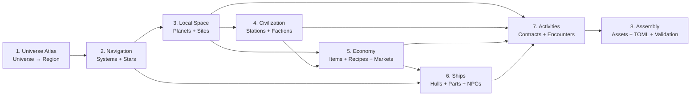

The main direction is top-down: broad containers first, concrete playable content later.

```mermaid
flowchart TD
    U[Universe]
    GG[Galaxy Group]
    GC[Galaxy Cluster]
    G[Galaxy]
    R[Region]
    S[System]
    STAR[Primary Star]
    P[Planets and Sites]
    SET[Stations and Settlements]
    ECO[Items, Recipes, Markets, Research]
    SHIP[Player Ships and Loadouts]
    NPC[NPC Ships, Captains, Crews]
    ACT[Contracts and Encounters]
    ASSET[Assets and Final Assembly]

    U --> GG
    GG --> GC
    GC --> G
    G --> R
    R --> S

    S --> STAR
    S --> P
    S --> SET

    P --> ECO
    SET --> ECO

    ECO --> SHIP
    S --> NPC
    ECO --> NPC

    P --> ACT
    SET --> ACT
    ECO --> ACT
    SHIP --> ACT
    NPC --> ACT

    STAR --> ASSET
    P --> ASSET
    SET --> ASSET
    SHIP --> ASSET
    NPC --> ASSET
    ACT --> ASSET
```



In concrete schema terms:

```text
Universe
└── Galaxy Group
    └── Galaxy Cluster
        └── Galaxy
            └── Region
                └── System
                    ├── Primary Star
                    ├── Planets
                    ├── Stations
                    └── NPC ships
```

A few potentially confusing details:

- A system belongs to a region and may also directly record its galaxy and universe.
- A planet belongs directly to a system.
- A star belongs directly to a system.
- A station currently belongs to a system, not directly to a planet. Its position can make it appear near one.
- A player ship is not permanently assigned to a system; the active owned ship moves between systems.
- An NPC ship is assigned to a system.
- Contracts reference already-existing stations, planets, services, items, factions, and actors.

The implementation stages would therefore look like this:



Each box becomes its own pipeline:

```text
Load approved parent layers
        ↓
Build context for this layer only
        ↓
Generate a small proposal
        ↓
Resolve IDs and runtime mechanics
        ↓
Deterministic validation
        ↓
Human review
        ↓
Save immutable approved revision
        ↓
Unlock the next layer
```

For the first playable slice, we do not need a huge universe. We can make each stage intentionally tiny:

```text
1 universe
→ 1 galaxy group
→ 1 cluster
→ 1 galaxy
→ 1 region
→ 2 systems and 2 stars
→ 2–4 planets
→ 1–2 stations
→ minimum viable fuel/material economy
→ 1 ship with an installed warp drive
→ 1 contract that sends that ship between systems
```

That is the shortest dependency-correct path from “top of the setting” to “a ship can warp somewhere for a reason.”